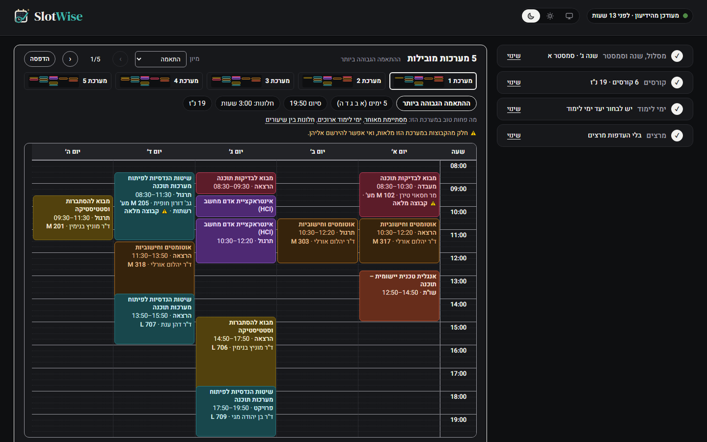
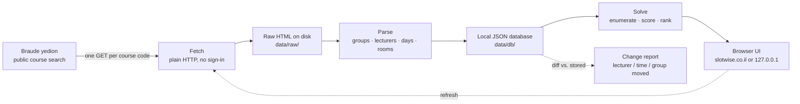

# SlotWise

**Reads Braude College's course catalogue (the *yedion*) and builds the best possible semester timetable — for any department, without ever seeing your password.**

- **Use it online: [slotwise.co.il](https://slotwise.co.il).** Nothing to install, no account.
- **Or run it on your own machine** — see [Quick start](#quick-start).





## Why it exists

Registration at Braude means opening the yedion, reading one course page at a
time, and assembling a timetable by hand. Every course has several lecture,
tutorial and lab groups, some groups are only valid together, and the things you
actually care about — *which lecturer, how many days on campus, how long the
gaps are* — are invisible until the grid is already drawn. Doing it by hand gets
you **a** timetable; it cannot tell you whether a better one existed, or that
four days on campus is impossible and five is the minimum. SlotWise enumerates
every legal combination, scores each one, shows you the best — then keeps
watching, so a lecturer or time that changes after you registered is noticed.

## How it works

1. **Fetch.** The yedion's course-search screen is readable without signing in,
   so the fetcher is plain `urllib` — one polite GET per course code, no browser
   and no credentials. Every page is written to `data/raw/` *before* it is
   parsed, so a parser fix can be re-run without touching the college's server.
2. **Parse and store.** Each page becomes `Meeting ⊂ Group ⊂ Course` in a JSON
   database under `data/db/`. Each refresh diffs against what was stored and
   reports what moved.
3. **Solve.** Backtracking enumeration walks every legal selection with pruning,
   scores each one, keeps the best. Exhaustive rather than heuristic — only a full
   count can say "no timetable satisfies this" or "these really are the top five".
4. **Show.** A Flask app serves a five-step Hebrew RTL interface: program and
   semester → courses → target days → lecturers → the grid. Every change
   re-solves immediately. Plain HTML, CSS and JS — no framework, no build step,
   no CDN.

A catalog of every course the college opens this year ships in the repo, so a
fresh clone has data on the first run. All eight Braude degree programs are
listed, and seven also ship a parsed curriculum, so the course list for a given
semester comes pre-filled rather than typed.

`data/catalog/` is rebuilt nightly by a GitHub Actions workflow and committed,
and the app serves it directly. The hosted site serves the catalog its image was
built with and never fetches from the yedion per request. **`git pull` is how a
local install gets fresh course data.** A record you scraped yourself only keeps
winning while it is newer than the catalog's build date, so the date in the
header is the catalog's, not a stale timestamp left in `data/db`. To rebuild
`data/db` itself from the catalog you just pulled:
`python scripts/seed_dev_data.py --force`. See DEPLOY.md, "Where the freshness
date comes from".

## What the engine enforces

Hard constraints — these reject a combination outright:

- **No overlaps**, as a half-open interval `[start, end)`: a class ending at
  10:15 and one starting at 10:15 do not collide. The one exception: a lesson
  you marked as not requiring attendance may overlap another lesson.
- **Linked groups.** The yedion marks "groups related to this course" — a given
  lecture requires a given tutorial. Ignoring it would produce timetables you
  cannot actually register for.
- **Tied courses.** Courses the curriculum declares inseparable are taken
  together or not at all; a missing one is a loud error, not a wrong timetable.
- **One group per component** — exactly one lecture, one tutorial, one lab.
- **Semester filter.** A course can open in both semesters and the yedion shows
  both on one page; only the requested semester's meetings are kept.
- **Your availability** — earliest start, latest finish, blocked windows, and an
  optional "no Friday".

Soft preferences decide the order of the timetables that remain. They are
compared **by priority, not summed**: each step settles the order completely,
and the next step only breaks ties left by the one before it.

1. **Days over the target.** Fewer is better. Every day with a lesson counts,
   including a day whose lessons are all marked as not requiring attendance.
2. **Lecturer ranks.** Only components you ranked lecturers for count. The
   timetable with more components at rank 1 wins; on a tie, the one where more
   of those are lectures (lecture or שו"ת). Then the same for rank 2, rank 3,
   and so on. A lecturer not on your list counts below your last rank.
3. **Intentional overlaps.** Fewer is better. An overlap can only involve a
   lesson you marked as not requiring attendance.
4. **Gaps, late finish and day length** — the only step that adds up points:

   ```
   score = − 4 × gap_hours           (the fixed 12:20–12:50 lunch window is free)
           − 4 × hours_past_14:00    (each day, from 14:00 to its last class)
           − 1 × day_span_hours      (each day, first class to last, summed)
   ```

   Higher is better. Only the part of a gap inside the lunch window is free; a
   class that runs straight through it earns nothing. The breakdown also shows
   −6 per intentional overlap, but by this step every timetable being compared
   has the same number of them, so it never changes the order.
5. **Tie-breakers:** fewer campus days, fewer total gap minutes, shorter total
   day span, then a fixed key built from the group ids, so the order is
   identical on every run.

So a lecturer at rank 1 is never traded for gap hours. Say the target is four
days. Timetable A has four days, your rank-1 lecturer and three hours of gaps;
B has four days, your rank-2 lecturer and no gaps. A wins at step 2 and the
gaps never come into it. A five-day timetable with every lecturer at rank 1
and no gaps loses to both at step 1.

The day target is **soft**: if four days is impossible you get the best
timetables among those that use the fewest possible days, with your lecturer
ranks honoured inside that set, not a failure. If nothing is feasible, the
solver raises with a concrete explanation — which course, which group, which
day and hour collide — plus suggested relaxations.

## Quick start

The easiest way is the hosted site: **[slotwise.co.il](https://slotwise.co.il)**.

To run it locally instead:

```bash
# Python 3.10+
git clone https://github.com/netabaron/SlotWise.git
cd SlotWise
python -m pip install -r requirements.txt
python main.py
```

That starts the local server and opens the app. There is nothing to configure —
pick a program and semester in step 1 and go. Copying `data/profile.example.json`
to `data/profile.json` pre-fills those choices, but it is optional.

The other requirements files are for other jobs:

| File | For |
| --- | --- |
| `requirements.txt` | the app itself, local or hosted |
| `requirements-dev.txt` | the test suite (pytest, pytest-xdist) |
| `requirements-scraper.txt` | Playwright: the `--browser` fetch fallback and the browser tests (then `python -m playwright install chromium`) |
| `requirements-loadtest.txt` | Locust, for the load test only |

The terminal flow, the scheduled refresh job and offline re-parsing are
documented in **[docs/CLI.md](docs/CLI.md)**. Hosting is documented in
**[DEPLOY.md](DEPLOY.md)**.

## Privacy

### The hosted site

- **No accounts, no password.** There is no sign-up and no login field anywhere,
  and the site never contacts the yedion on your behalf: it serves a catalog
  that was built ahead of time.
- **Your selections stay in your browser**, in `localStorage`. The server keeps
  no record of them; each request carries what it needs to compute a timetable,
  and the answer goes back to your browser.
- **A per-IP rate limit** on `/api/*` stops one client from flooding the
  server. It keeps a usage counter per IP address in server memory only, never
  on disk. Like any web server, requests — including the IP address — appear in
  the hosting provider's request logs.
- **Hosted on Google Cloud Run, region `europe-west1`** (Belgium).

### Running it locally

- **Nothing is hosted.** The server binds to `127.0.0.1` only, and the only
  outside traffic is the fetch from the yedion. Your selections live in your
  browser's `localStorage`.
- **The app never handles your password.** The default fetch path is anonymous
  — the yedion's course search answers a plain GET. The cookie jar lives in
  memory and is never written to disk.
- On the optional `--browser` fallback path you sign in yourself, in a real
  browser window. Even there nothing reads, asks for or stores credentials, and a
  page that is not from `info.braude.ac.il` is **never written to disk** — not as
  HTML, not as a screenshot — so an autofilled login page cannot reach
  `data/raw/`.

## Layout

```
main.py                 launcher: the browser app by default, --cli for the terminal
webapp.py               the local Flask server (127.0.0.1)
wsgi.py                 the hosted entry point: network off, binds 0.0.0.0
gunicorn.conf.py        gunicorn settings for the hosted server
Dockerfile              the image Cloud Run serves
src/yedion_http.py      login-free fetcher — stdlib only, verified year protocol
src/parser.py           yedion HTML -> model; models.py = Meeting / Group / Course
src/scheduler.py        the engine: constraints, scoring, search, infeasibility diagnosis
src/store.py            JSON database: freshness, change detection, atomic writes
src/curriculum.py       curricula, prerequisites, tied courses; discovery.py = live catalog
src/rate_limit.py       per-IP limit on /api/*, charged in CPU seconds (hosted only)
src/web/                the JSON API and the interface (plain HTML/CSS/JS)
build_catalog.py        builds data/catalog/ from the yedion
refresh.py              the scheduled refresh job; reparse.py re-parses saved HTML offline
data/catalog/           the shipped catalog, so a fresh clone has data
scripts/                verify_catalog.py, seed_dev_data.py, update_test_fixture.py
scripts/loadtest/       the Locust load test and its pass/fail thresholds
.github/workflows/      ci.yml (every push), build-catalog.yml (nightly),
                        loadtest.yml (manual only)
docs/                   CLI reference, the verified yedion protocol, the specs,
                        the design, the development log
tests/                  the test suite — see below
```

## Tests

```bash
python -m pip install -r requirements.txt -r requirements-dev.txt -r requirements-scraper.txt
python -m playwright install chromium
python -m pytest -q -n 4 --dist loadfile
```

- **No network.** Nothing in the suite fetches from the yedion.
- **A frozen catalog.** Tests read `tests/fixtures/catalog`, a fixed copy, so the
  nightly catalog build cannot break them. One invariants test checks the real
  `data/catalog/`.
- **Browser tests.** Interface rules that live in `app.js` are tested by driving
  a local Chromium through Playwright. They skip themselves when no browser is
  installed.
- **CI on every push.** `.github/workflows/ci.yml` runs the suite, then builds
  the Docker image and checks that it serves.

Keep `--dist loadfile`: several modules share one browser page across their
tests, so each file has to stay on one worker. Without `-n` the suite runs
serially, which works but is much slower.

## Roadmap

Done:

- Hosted at [slotwise.co.il](https://slotwise.co.il) — Cloud Run and gunicorn,
  with a per-IP rate limit and a load test
- A nightly catalog build, committed by GitHub Actions

Next:

- **Export to `.ics` calendar** — drop the finished timetable straight into
  Google Calendar
- Exam dates in the model, so timetables can be scored on exam spacing too
- A parsed curriculum for the one remaining degree program
- Semester ב timetabling: the groups are already published, but the yedion
  carries no times for them yet
